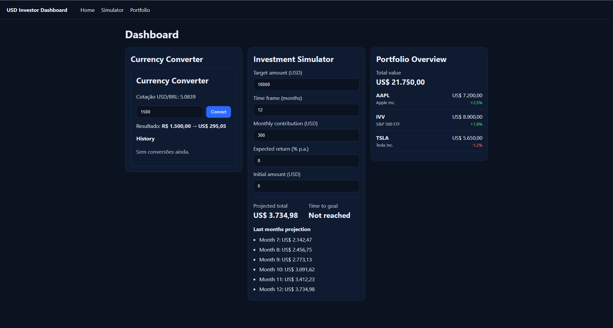

<!-- BANNER SUPERIOR -->
<div align="center">

# 📈 Investment Simulator

Interactive financial simulator designed to calculate investment growth over time based on user-defined inputs.

[](https://investment-henna-rho.vercel.app/)

</div>

---

## 📋 About the Project

This project is a financial simulator that calculates the growth of an investment over time, based on parameters such as initial capital, monthly contributions, and interest rate.

The application dynamically updates the results, allowing users to visualize how different variables impact long-term returns.

The main goal of this project was to practice **financial logic**, **dynamic calculations**, and **interactive frontend development**.

---

## 🛠️ Technologies Used

<div align="center">


</div>

---

## ✨ Features

- Investment growth simulation
- Adjustable initial investment and monthly contributions
- Interest rate configuration
- Dynamic calculation of returns over time
- Clear and interactive user interface

---

## 📷 Preview

<div align="center">



</div>

---

## 🚀 Installation and Usage

### Step by step

```bash
# Clone the repository
git clone https://github.com/vilhegas/investment-Simulator.git

# Enter the project folder
cd investment-Simulator
